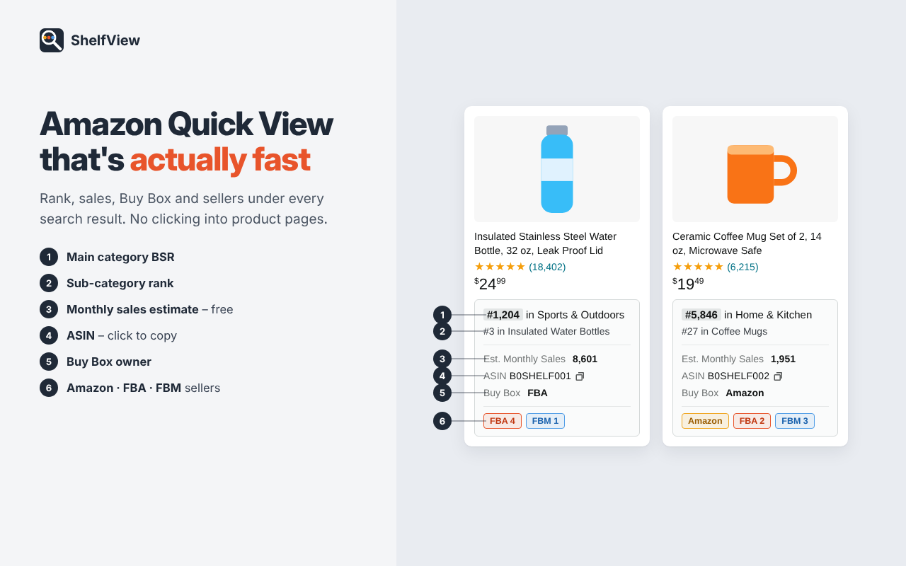

  

<h1 align="center">ShelfView</h1>

<b>Fast Amazon Quick View with free monthly sales estimates, BSR, Buy Box and FBA &amp; FBM sellers.</b>

  <a href="https://chromewebstore.google.com/detail/YOUR-EXTENSION-ID">Get it on the Chrome Web Store</a> ·
  <a href="https://ecomstool.github.io/shelfview/">Website</a> ·
  <a href="PRIVACY.md">Privacy policy</a>

ShelfView adds one clean box under every product on Amazon search and Best Sellers pages:

- **Best Sellers Rank** – main category and sub-category
- **Estimated monthly sales** – free, no login
- **Buy Box owner** – Amazon, FBA or FBM
- **Amazon, FBA and FBM seller counts** – new offers only, each seller counted once
- **ASIN** with one-click copy

Fast, clean, private, and it works on all Amazon marketplaces.

## Support

Questions, bugs or ideas: open an issue in this repository or email **ecomstool@gmail.com**.

---

ShelfView is not affiliated with or endorsed by Amazon. Amazon is a trademark of Amazon.com, Inc. or its affiliates.
